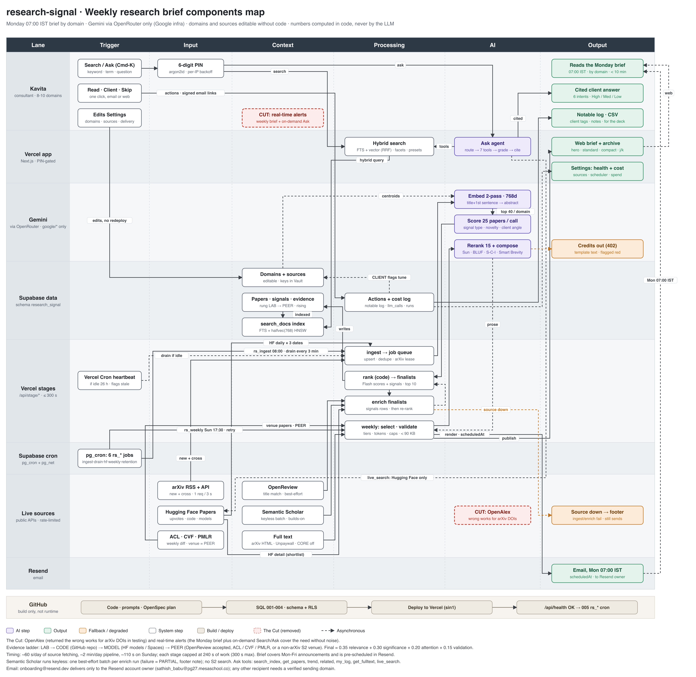

# Components map



The map is a swimlane: each row is a lane (who or what owns the work) and each column is a step (Trigger → Input → Context → Processing → AI → Output). Solid arrows are synchronous calls; dashed arrows are asynchronous or best-effort. The source is [`diagrams/components-map.py`](diagrams/components-map.py); regenerate it from the repo root with:

```sh
python3 docs/diagrams/components-map.py
rsvg-convert -z 1.5 docs/diagrams/components-map.svg -o docs/diagrams/components-map.png
```

Related diagrams: [architecture](diagrams/architecture.png) ([source](diagrams/architecture.mmd)) and [user flow](diagrams/user-flow.png) ([source](diagrams/user-flow.mmd)).

## Lanes

**Kavita.** The one user, a technology-strategy consultant who follows 8-10 domains. She signs in with a 6-digit PIN (stored as an argon2id hash, with per-IP backoff), searches or asks through Cmd-K, marks papers Read, Client or Skip with one click from the email or the web, and edits domains, sources and delivery in Settings. What she gets back is the Monday brief at 07:00 IST (organised by domain, under ten minutes to read), cited client answers graded High / Med / Low, and a notable log with client tags and notes that exports to CSV for her decks. Real-time alerts were cut: the weekly brief plus on-demand Search and Ask cover the need without noise.

**Vercel app.** The PIN-gated Next.js app. Hybrid search fuses Postgres full-text search with vector search by reciprocal rank fusion and adds facets and presets. The Ask agent routes a question to one of six intents, calls up to seven tools (`search_index`, `get_papers`, `trend`, `related`, `my_log`, `get_fulltext`, `live_search`), grades the evidence and cites it. The app also serves the web brief and its archive (hero, standard and compact tiers, `j`/`k` navigation) and the Settings health and cost views (source status, scheduler state, LLM spend).

**Gemini.** All model calls go through OpenRouter to `google/*` models only. Papers are embedded in two passes at 768 dimensions (title plus first sentence, then the abstract) and matched against domain centroids; the top 40 per domain are scored in batches of 25 (signal type, novelty, client angle). On Sunday the finalists are reranked (15 per domain) and composed into BLUF and Situation-Complication-Implication prose in a Smart Brevity style. If OpenRouter returns 402 (credits out), the brief falls back to template text and is flagged red.

**Supabase data.** Everything lives in the `research_signal` schema of the shared Supabase project. Domains and sources are editable rows (source keys sit in Vault); papers carry signals and an evidence rung that climbs LAB → CODE → MODEL → PEER, plus a rising flag. The `search_docs` index holds the full-text vectors and a `halfvec(768)` HNSW index. Actions and the cost log record the notable log, every LLM call and every pipeline run; Client flags feed back into the domain profiles.

**Vercel stages.** The pipeline runs as `/api/stage/*` route handlers, each capped at 240 s of work inside Vercel's 300 s limit. Ingest upserts and dedupes into a job queue (arXiv is fetched under a lease to respect 1 request per 3 s); rank is computed in code from the Flash scores and signals to pick the top 10 finalists; enrich adds signal rows and triggers a re-rank; on Sunday the weekly stage selects, validates tiers, token counts and caps, and keeps the email under 90 KB before rendering and publishing it. A Vercel Cron heartbeat drains the queue and flags the scheduler as stale if nothing has run for 26 hours.

**Supabase cron.** Six `rs_*` jobs in `pg_cron`, called over `pg_net`, drive the stages: daily ingest at 08:00, a queue drain every 3 minutes, the Hugging Face refresh, the Sunday 17:30 weekly run with retry, and retention.

**Live sources.** Public, rate-limited APIs: arXiv RSS plus the export API (new and cross-listed papers), Hugging Face Papers (upvotes, code and model links), and a weekly diff of ACL, CVF and PMLR proceedings (venue papers enter at PEER). Enrich adds OpenReview (best-effort title match), Semantic Scholar (one keyless batch per run, no search) and full text from arXiv HTML or Unpaywall (CORE off by default). The Ask agent's `live_search` reaches Hugging Face only. OpenAlex was cut because it returned the wrong works for arXiv DOIs in testing. If a source is down, ingest or enrich still completes and the brief notes it in the footer.

**Resend.** The rendered brief is handed to Resend with `scheduledAt` so it lands at Monday 07:00 IST. While the sender is `onboarding@resend.dev`, Resend delivers only to the account owner; any other recipient needs a verified sending domain.

**GitHub (build strip).** Build only, not runtime: code, prompts and the OpenSpec plan; SQL 001-004 (schema and RLS); deploy to Vercel in `sin1`; and only once `/api/health` is OK, the 005 SQL that creates the `rs_*` cron jobs.

## Legend

| Style | Meaning |
| --- | --- |
| Purple box | AI step (a Gemini call through OpenRouter) |
| Green box | Output Kavita sees |
| Orange box, orange arrow | Fallback or degraded path |
| White box | System step (code, data or an external API) |
| Beige box | Build or deploy step |
| Red dashed box | The Cut: considered and removed |
| Dashed arrow | Asynchronous or best-effort |
