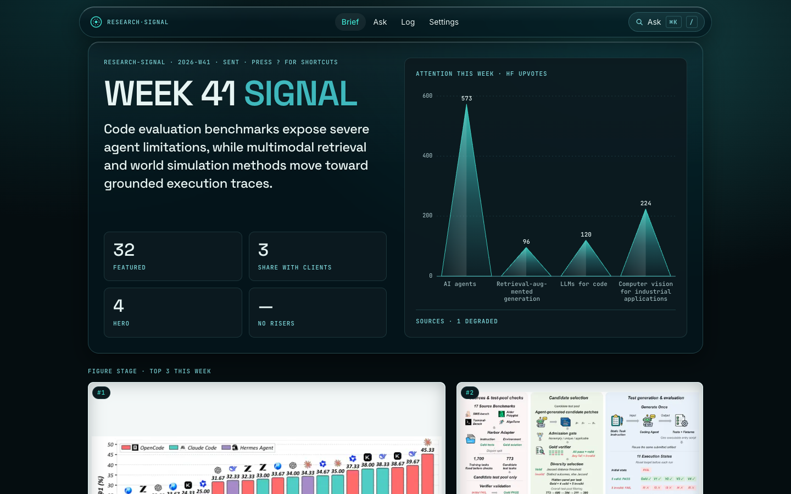
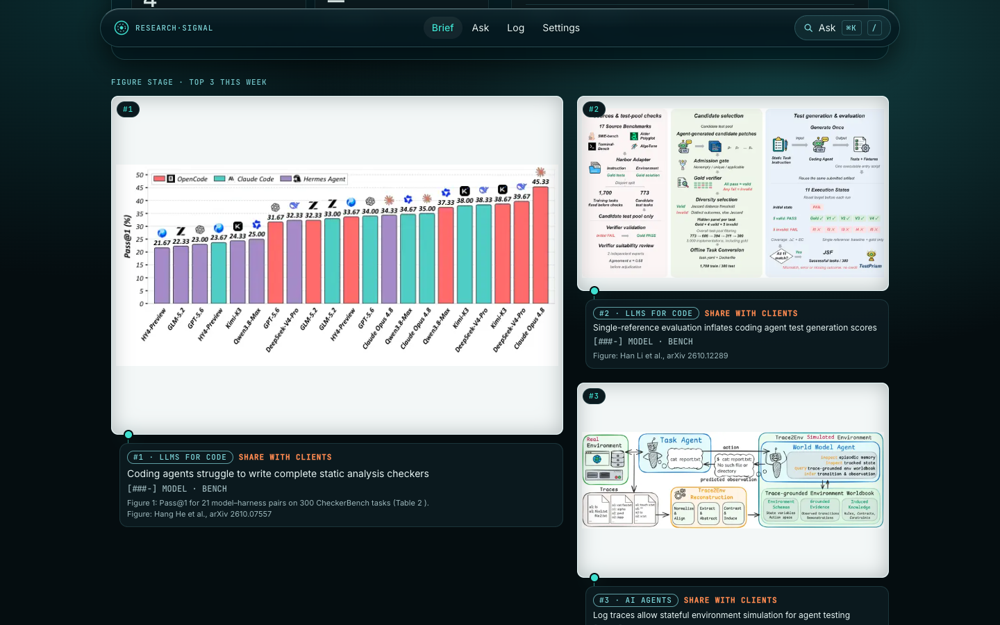
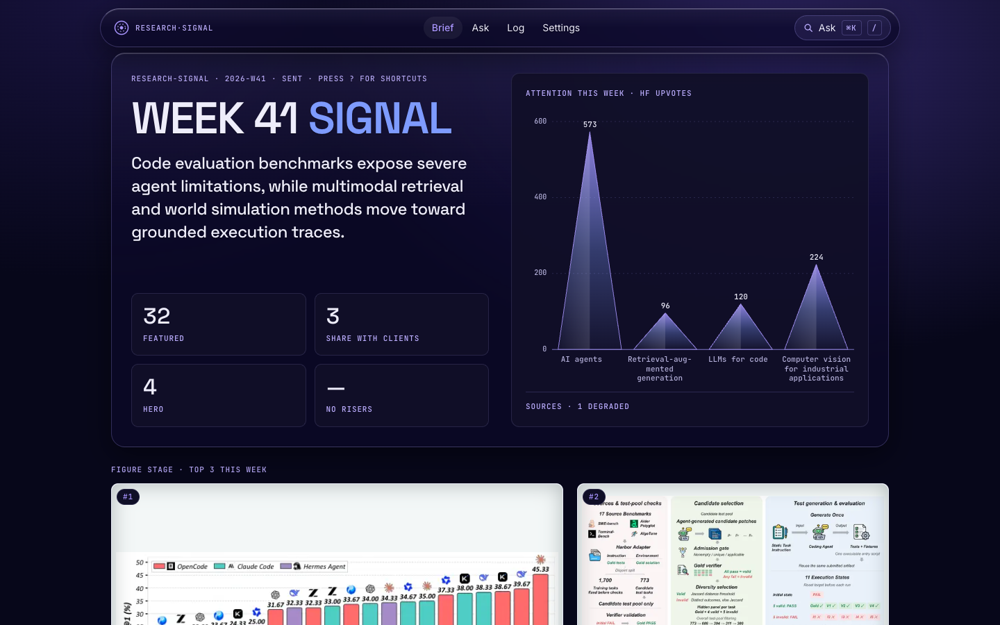
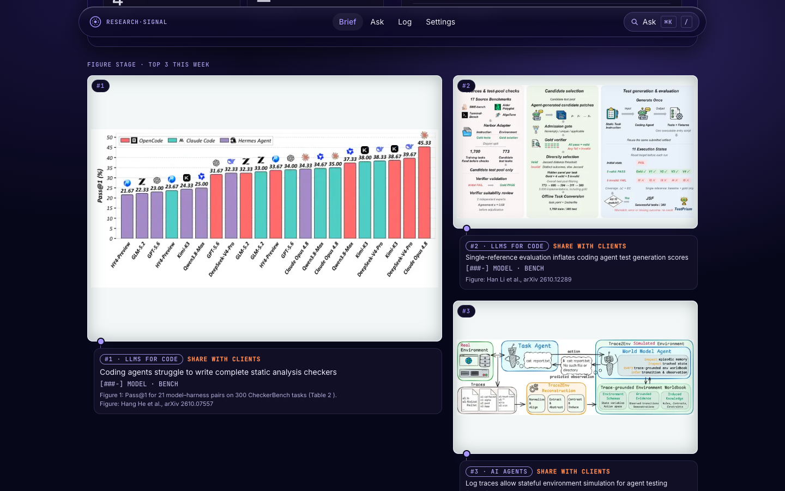
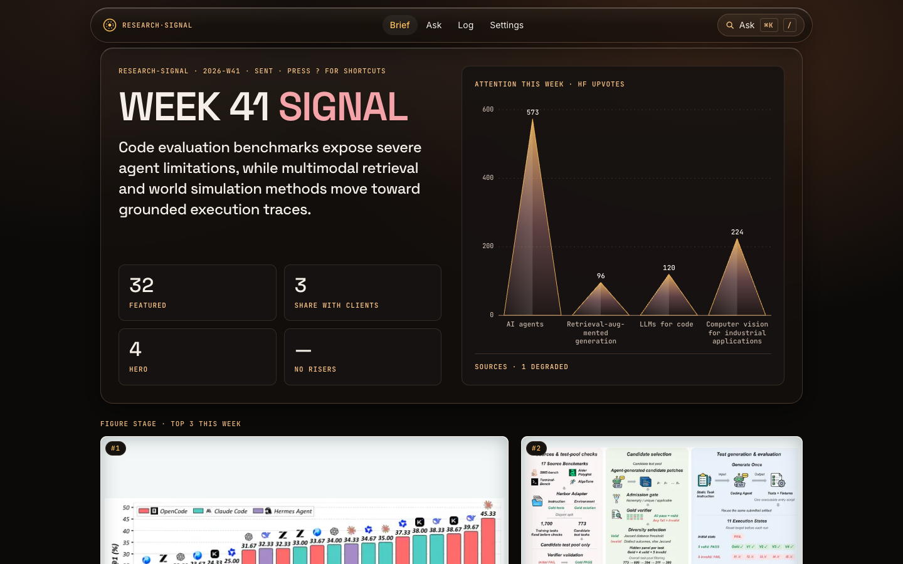
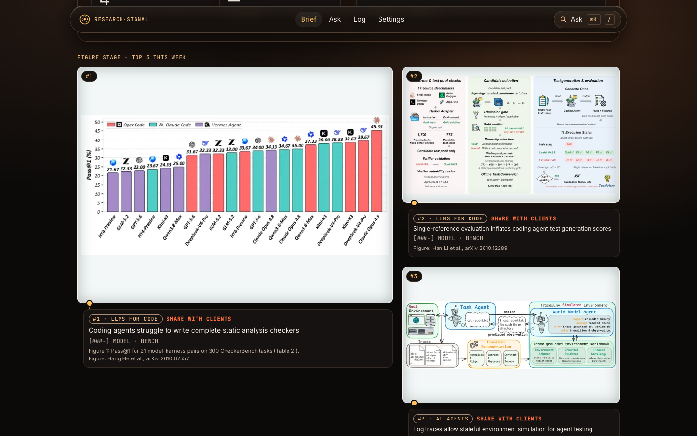
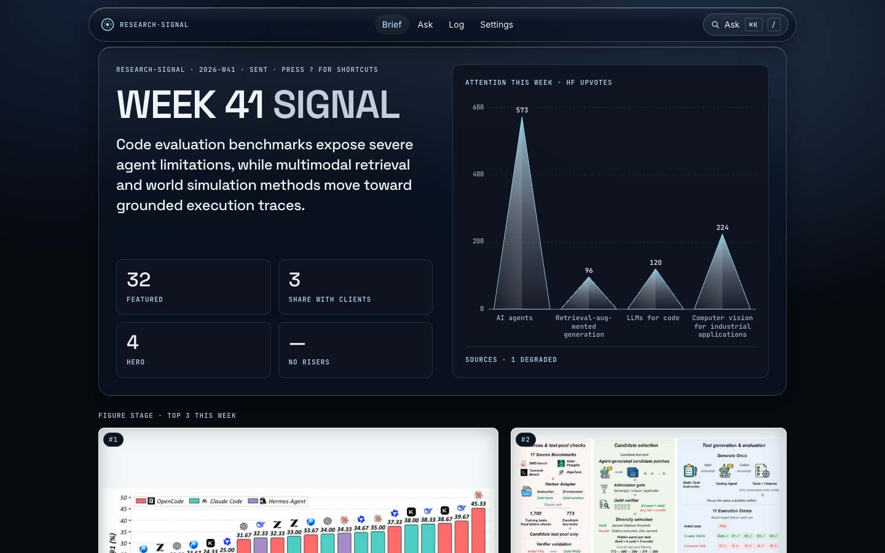
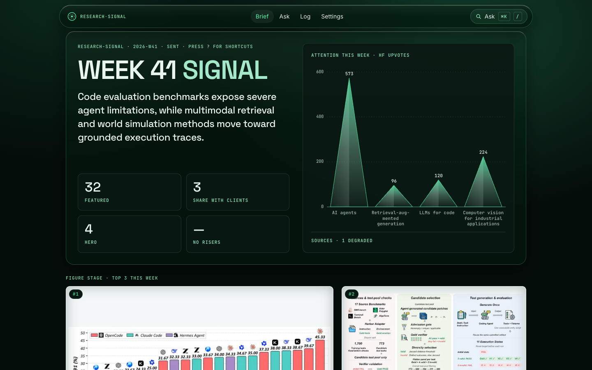
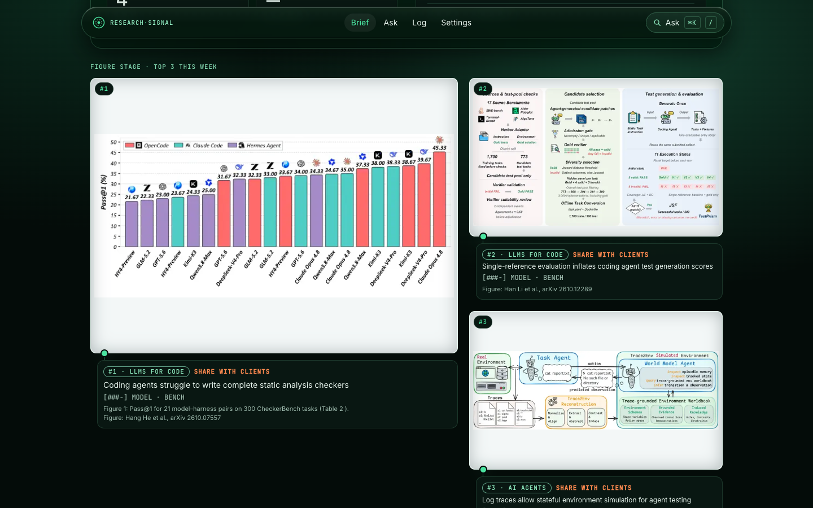

# Liquid-glass palette proposals

These are four alternatives to the current teal "Signal" palette for the dark brief dashboard. Each `*.css` file replaces the `:root` token block in `src/app/globals.css` and uses the same token names. No source file was edited. The previews were rendered by injecting each file into the running dev server.

## Summary

| Palette | Mood | Key hexes (bg-0 · glow peak · signal · signal-2 · focus) | Min text contrast | Min non-text (3:1) | Recommendation |
|---|---|---|---|---|---|
| **Signal (current teal)** (`signal.css`) | Bioinformatics cockpit: deep petrol, cyan instrument light | `#050D10` · `#1E6B6E` · `#3FE0D0` · `#3FB8BD` · `#7FDBFF` | 4.79:1 (signal-2 on nav/particle) | 3.76:1 (chip-border on nav/particle) | Baseline. Keep if the brand stays "bioinformatics cockpit"; rising green sits close to the teal accent (dE 14.0). |
| **Aurora** (`aurora.css`) | Night-sky violet-blue glass, cool and calm; magenta focus ring | `#07071A` · `#4A3A9A` · `#A995FF` · `#7E9BFF` · `#FFA8F0` | 5.45:1 (signal-2 on chip/plate) | 3.78:1 (rule on chip/plate) | **Recommended.** Most distinct from today while keeping every text token at or above 5.45:1; violet accent never collides with a verdict hue, and the magenta focus ring is unmistakable. |
| **Ember** (`ember.css`) | Deep graphite with warm amber/coral light; cyan focus ring for contrast | `#0B0A09` · `#663A22` · `#FFC15C` · `#F4A3A8` · `#7FDBFF` | 4.83:1 (CLIENT on chip/plate) | 4.04:1 (chip-border on nav/particle) | Warmest and most "premium"; good for evening reading. CLIENT was pushed to #FF6F3C to separate it from the amber accent, so COLORS_UI must change too. |
| **Glacier** (`glacier.css`) | Cool ice-blue and brushed silver, crisp and clinical; warm gold focus ring | `#060A11` · `#36567C` · `#A6DDF7` · `#C3CEDC` · `#FFD166` | 5.14:1 (READ on chip/plate) | 3.96:1 (rule on nav/particle) | Cleanest/most clinical, but the pale accent reads almost silver ("SIGNAL" heading loses pop) and READ sits closest to the accent (dE 17.8). Second choice for a neutral corporate look. |
| **Verdant** (`verdant.css`) | Emerald-mint on near-black, botanical lab; lime for rising so it does not merge with the accent | `#040C09` · `#1D684A` · `#4BE3A0` · `#A3E9C9` · `#7FDBFF` | 5.48:1 (CLIENT on chip/plate) | 3.91:1 (chip-border on nav/particle) | Lowest-risk alternative: same lightness structure as teal shifted to emerald. Rising moves to lime #C6F06A so it does not merge with the accent. |

Previews are 1440×900 at DPR 1, from `/brief/2026-W41` on the local dev server.

| Palette | Hero | Figure stage |
|---|---|---|
| Signal (current teal) |  |  |
| Aurora |  |  |
| Ember |  |  |
| Glacier |  |  |
| Verdant |  |  |

## How contrast was measured

The method is the same as `docs/design/contrast.py` and spec §2.1, applied to each palette's own backdrop. Each translucent surface is flattened with `over(tint, α, backdrop)` and compared using the WCAG 2.x relative-luminance ratio. The worst-case backdrops are:

- `--bg-glow-peak`, the brightest page-glow stop, sits behind the hero glass, the dialogs and the plates.
- `--signal`, the particle core, passes under the sticky nav and under the plates when the page scrolls.
- `chip/plate` is the `.glass-chip` fill flattened over the worst plate. It is the lightest surface any verdict label sits on, so it is the worst case for verdict text.

Verdict text and rising text are never placed on the nav, so they are not measured against it.

The thresholds are:
- Text needs 4.5:1. The verdict labels are 11px, so they count as normal text.
- Non-text needs 3:1. This covers chip-border/`--input`, rule and the focus ring.
- `--primary-foreground` on `--signal` needs 4.5:1.

**Every palette passes every pair.** The full minimum per foreground (and the surface where it is lowest) is below.

| Foreground | Signal | Aurora | Ember | Glacier | Verdant |
|---|---|---|---|---|---|
| text | 10.13 nav/particle | 12.34 chip/plate | 11.01 nav/particle | 11.02 nav/particle | 10.35 nav/particle |
| muted | 5.46 nav/particle | 6.84 chip/plate | 6.23 nav/particle | 6.11 nav/particle | 5.71 nav/particle |
| micro | 7.01 nav/particle | 7.23 chip/plate | 8.35 nav/particle | 8.85 nav/particle | 8.13 nav/particle |
| signal | 6.96 nav/particle | 5.73 chip/plate | 7.79 nav/particle | 8.32 nav/particle | 7.02 nav/particle |
| signal-2 | 4.79 nav/particle | 5.45 chip/plate | 6.36 nav/particle | 7.66 nav/particle | 8.26 nav/particle |
| CLIENT | 5.32 chip/plate | 6.12 chip/plate | 4.83 chip/plate | 5.58 chip/plate | 5.48 chip/plate |
| READ | 5.38 chip/plate | 6.19 chip/plate | 5.79 chip/plate | 5.14 chip/plate | 5.54 chip/plate |
| SKIP | 5.55 chip/plate | 6.13 chip/plate | 5.79 chip/plate | 5.45 chip/plate | 5.73 chip/plate |
| rising | 7.02 chip/plate | 8.08 chip/plate | 7.56 chip/plate | 7.37 chip/plate | 9.79 chip/plate |
| chip-border | 3.76 nav/particle | 4.35 chip/plate | 4.04 nav/particle | 4.03 nav/particle | 3.91 nav/particle |
| rule | 3.89 nav/particle | 3.78 chip/plate | 4.04 nav/particle | 3.96 nav/particle | 4.06 nav/particle |
| focus | 7.34 nav/particle | 8.24 chip/plate | 8.05 nav/particle | 8.47 nav/particle | 7.4 nav/particle |
| primary-fg on signal | 10.41 | 7.52 | 10.68 | 11.81 | 10.51 |
| destructive on destructive/10 | 4.8 | 5.32 | 5.02 | 4.95 | 4.98 |
| more-contrast muted on glass-solid / plate-solid (min) | 10.19 | 11.16 | 11.3 | 11.52 | 10.71 |

Flattened worst-case surfaces:

| Surface | Signal | Aurora | Ember | Glacier | Verdant |
|---|---|---|---|---|---|
| glass/peak | `#0F383C` | `#221B4E` | `#332015` | `#1A2A41` | `#0F3625` |
| nav/particle | `#114042` | `#28234B` | `#40311C` | `#263747` | `#14412C` |
| elev/peak | `#0D2F34` | `#1C1744` | `#2B1D15` | `#152337` | `#0D2E21` |
| plate/peak | `#0D2025` | `#151230` | `#1D1612` | `#111926` | `#0C1E17` |
| plate/particle | `#102A2D` | `#1C1A38` | `#2A2117` | `#1A242F` | `#0F281E` |
| plate-hover | `#12272C` | `#18173A` | `#221C18` | `#151E2C` | `#10241C` |
| glass-solid | `#0F2227` | `#141233` | `#1D1814` | `#111A27` | `#0F2219` |
| canvas | `#050D10` | `#07071A` | `#0B0A09` | `#060A11` | `#040C09` |
| chip/plate | `#19393C` | `#29264A` | `#392D21` | `#27323E` | `#19382B` |

## Verdict distinguishability (CIEDE2000 ΔE)

Verdicts are always paired with a text label, so colour is a second cue and never the only one. The thresholds below are rules of thumb. A ΔE above 20 reads as clearly different. Between 10 and 20 the colours can be told apart side by side. The deutan column uses the Machado et al. 2009 deuteranopia matrix at severity 1.0.

| Pair | Signal | Aurora | Ember | Glacier | Verdant |
|---|---|---|---|---|---|
| CLIENT-READ | 49.0 / 50.5deutan | 49.0 / 50.5deutan | 51.7 / 51.4deutan | 47.3 / 56.1deutan | 49.0 / 50.5deutan |
| CLIENT-SKIP | 31.2 / 31.2deutan | 32.1 / 34.8deutan | 27.3 / 23.4deutan | 30.2 / 30.3deutan | 29.3 / 24.0deutan |
| READ-SKIP | 17.3 / 15.8deutan | 23.3 / 13.2deutan | 23.5 / 24.5deutan | 19.3 / 20.7deutan | 20.9 / 21.4deutan |
| signal vs CLIENT | 53.8 | 44.4 | 26.9 | 46.6 | 57.7 |
| signal vs READ | 25.4 | 23.0 | 51.4 | 17.8 | 38.9 |
| signal vs SKIP | 25.3 | 17.7 | 25.3 | 17.9 | 25.1 |
| signal vs rising | 14.0 | 48.1 | 39.7 | 32.1 | 19.5 |
| signal-2 vs CLIENT | 48.4 | 46.1 | 21.1 | 34.3 | 48.5 |
| signal-2 vs SKIP | 21.1 | 19.4 | 21.8 | 10.3 | 21.6 |
| focus vs signal | 19.4 | 18.9 | 45.8 | 41.7 | 33.2 |

Collisions to watch:
- **Glacier.**
  - READ vs accent: ΔE 17.8. READ changes from today's `COLORS_UI` `#56B4E9` to `#63A4FF`, a shift of ΔE 9.4. Today's `#56B4E9` would sit at only ΔE 13.0 from the ice accent `#A6DDF7`.
  - Signal-2 (silver) vs SKIP: ΔE 10.3. Signal-2 only colours chart series 2 and the particle strand, and never sits next to a verdict.
- **Ember.** CLIENT changes from `#FF8A50` to `#FF6F3C`, which is ΔE 26.9 from the amber accent `#FFC15C` (today's `#FF8A50` would be 20.6). Signal-2 is the rose-coral `#F4A3A8`, ΔE 21.1 from the new CLIENT.
- **Verdant.** Rising changes from `#3DDC97` to lime `#C6F06A`, which is ΔE 19.5 from the emerald accent `#4BE3A0`. Today's `#3DDC97` is only ΔE 1.9 from that accent, so the two would be indistinguishable.
- **Aurora** keeps the verdict trio identical to today. It also keeps the email's Okabe-Ito mapping.

## Adopting a palette (for the implementer)

1. **Tokens.** Replace the values in the `:root` block of `src/app/globals.css` with the values in the chosen file. If the file is imported after `globals.css` instead, keep its fallback blocks. A later `:root` would otherwise beat the no-backdrop-filter `@supports`, `prefers-reduced-transparency`, `data-glass="off"` and `prefers-contrast: more` blocks in `globals.css` and bring translucent glass back.
2. **Values hardcoded outside `:root`.**
   - The `@utility glass-chip` fill, `rgb(127 224 230 / .08)`. Each file overrides it inside `@layer utilities`, but adoption should edit the literal itself.
   - `--text-muted` under `prefers-contrast: more` (`#B9D0D3` today). Each file sets its own value.
   - `CardActions.tsx:41` uses `#03201D` as the text on the signal button. Use the palette's `--primary-foreground` instead.
   - `HelixParticles.tsx:73` has teal fallback hexes. They are only used when the token is empty.
3. **`COLORS_UI` in `src/lib/brief/cues.ts`.** The verdict bars, verdict labels and `UP +x%` colours are **inline styles** from `COLORS_UI`, not CSS tokens. Ember (CLIENT), Glacier (READ) and Verdant (rising) need `COLORS_UI` mirrored. The email's `COLORS` must stay unchanged. In these previews a preview-only `[style*=…]` shim stood in for that change. The shim is not part of the deliverable CSS.
4. **Spec.** If a palette is adopted, update the contrast tables in `docs/design/liquid-glass-spec.md` §2.1 and §7 from the tables above.

## How the previews were made

1. A session was minted in-process with `createSession()` and set as the `rs_session` cookie. The token was never printed or written.
2. The existing dev server for this directory, on `:3104`, was reused.
3. In headless Chromium 1243 (Playwright), the palette CSS was injected before `</head>` through `context.route`, so `HelixParticles` reads the new `--signal` when it mounts. The same CSS was then re-applied with `page.addStyleTag`.
4. Two screenshots were taken per palette: the hero, then the page scrolled to `#figure-stage-heading`.

Lead-figure images are paper figures and are never tinted, so they look the same under every palette.

**What the screenshots show and do not show.**
- All three top-3 cards in W41 are CLIENT, and the hero reads "NO RISERS". The screenshots therefore show Ember's CLIENT change, but not Glacier's READ change or Verdant's rising change. Those two are supported only by the tables above.
- The Ember shim was checked on the page. Elements with inline `#FF8A50` computed to `rgb(255, 111, 60)`, which is `#FF6F3C`.

